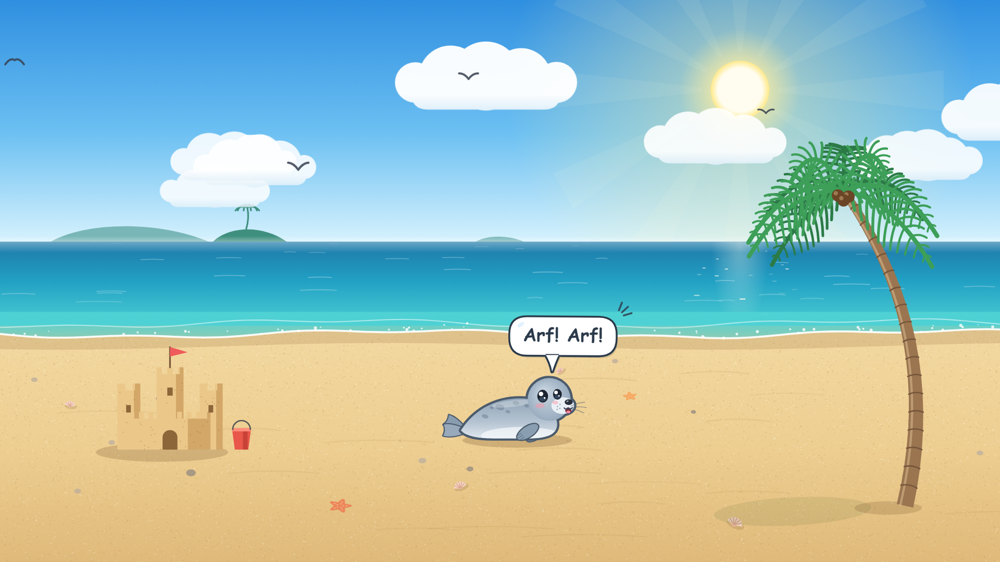
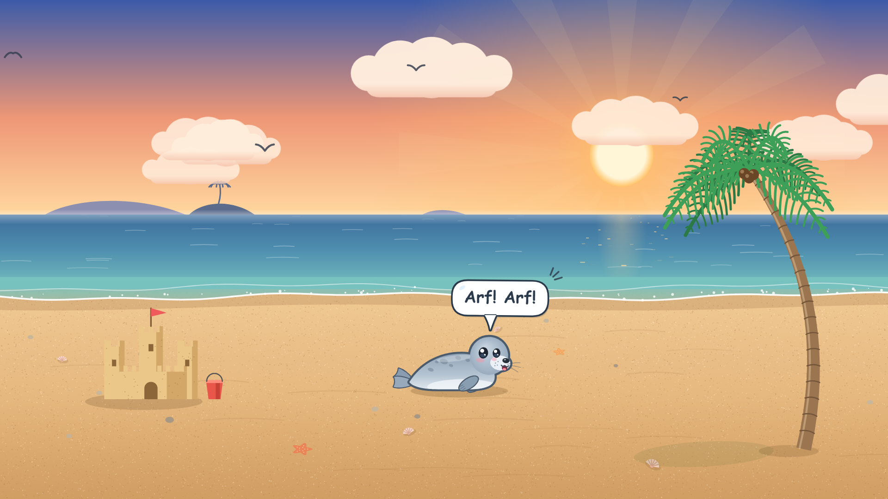

# 🦭 Seal Beach: an interactive live wallpaper

A cute grey seal pup lives on a sunny tropical beach on your desktop. **Click anywhere** and it flops over to that spot. **Click the seal** and a comic speech bubble pops out with a seal sound ("Arf! Arf!", "Hoonk!", "Ork ork ork!"…). The sounds are only written in the bubble, so it never plays any audio.

Made for [**Lively Wallpaper**](https://www.rocksdanister.com/lively/) on Windows, and it also runs in any modern browser.



<details>
<summary>Golden Hour mood</summary>



</details>

---

## ✨ Features

| | |
|---|---|
| 🦭 **Flopping seal** | It moves the way real seals do: the front end surges up, then it slumps down. Each flop kicks up sand and leaves flipper tracks that fade away. |
| 🖱️ **Follows your clicks** | Click anywhere and the seal turns around and flops there. Clicks in the sky or the sea send it to the nearest spot on the beach. |
| 👀 **Watches your cursor** | The head tilts and the eyes follow the mouse. If you move the cursor behind the seal, it turns around to look. |
| 💬 **Seal sounds** | Click the seal and a speech bubble pops out with a random sound. The seal makes happy `^ ^` eyes, claps its flippers, opens its mouth to "talk", and floats hearts and music notes. |
| 😴 **Naps** | Leave it alone for a while and it falls asleep, with closed eyes, a snot bubble and floating *z*'s. Click to wake it up ("Huh?! …Arf!"). |
| 🏝️ **Animated beach** | Turning sun rays, drifting clouds, flapping seagulls, sparkling water, wave crests, waves washing up the shore, a swaying palm tree and a sandcastle with a waving flag. |
| 🎨 **Two moods** | *Sunny Noon* or *Golden Hour*. |
| ⚙️ **Customisable** | Seal size and speed, bubble time, nap timer, your own seal sounds, toggles for scenery, and an FPS cap. All of these are set from Lively's **Customise** panel. |
| 🪶 **Lightweight** | Pure HTML5 Canvas and vanilla JavaScript. No frameworks, no build step, no internet needed. |

---

## 🚀 Install in Lively Wallpaper

### 1. Get Lively
Install **Lively Wallpaper** (free) from the [Microsoft Store](https://apps.microsoft.com/detail/9ntm2qc6qws7) or from [GitHub releases](https://github.com/rocksdanister/lively/releases).

### 2. Add the wallpaper
The easiest way is the ready-made zip:

1. Download [`release/SealBeach-Lively.zip`](release/SealBeach-Lively.zip) from this repo. Open the file on GitHub and click **Download raw file**.
2. Open Lively, then either:
   - **drag and drop** the zip onto Lively's library window, **or**
   - click **➕ Add Wallpaper** and browse to the zip.
3. Click **Seal Beach** in your library to set it as your wallpaper.

> ⚠️ Don't use GitHub's green **Code → Download ZIP** button for importing. That zip wraps everything in an extra folder, and Lively needs `LivelyInfo.json` at the root of the zip. Use the zip in `release/` instead, or build your own (see [Packaging](#-packaging-a-new-zip)).

### 3. Turn on mouse input
The seal can only react to clicks if Lively forwards the mouse to the wallpaper:

- Open Lively → **Settings** → **Wallpaper**, and set **Wallpaper Input** to **Mouse**.

Clicks reach the wallpaper when you click an **empty part of the desktop**, not a window or a desktop icon. To give the seal more room, right-click the desktop → **View** → untick **Show desktop icons**.

### 4. Customise (optional)
In Lively's library, right-click **Seal Beach** → **Customise** to open the settings panel (see [Settings](#%EF%B8%8F-settings)).

---

## 🖱️ How to play

| Action | What happens |
|---|---|
| Click anywhere on the beach | The seal flops over to that spot. |
| Click in the sky or the sea | The seal flops to the nearest spot on the sand. |
| Click **on** the seal | A speech bubble with a seal sound, plus hearts and a happy wiggle. |
| Move the mouse | The seal's head and eyes follow the cursor. |
| Leave it alone | After the nap timer runs out, it falls asleep. |
| Click while it sleeps | It wakes up with a surprised "!?" or "Huh?! …Arf!". |

---

## ⚙️ Settings

These are defined in [`LivelyProperties.json`](LivelyProperties.json) and show up in Lively's **Customise** panel.

| Setting | Type | Default | Description |
|---|---|---|---|
| Sky mood | dropdown | Sunny Noon | `Sunny Noon` or `Golden Hour`. |
| Seal size | slider 0.6 – 1.6 | 1 | Makes the seal bigger or smaller. |
| Flop speed | slider 0.5 – 2.5 | 1 | How fast the seal flops around. |
| Speech bubble time | slider 1 – 6 s | 2.5 | How long a bubble stays on screen. |
| Nap after idle | slider 0 – 180 s | 30 | Seconds without clicks before the seal naps. `0` means it never naps. |
| Seal sounds | text | *(12 sounds)* | Comma-separated list of things the seal can say. Emoji work too, e.g. `Arf!, Blub 🫧, Hoonk!` |
| Seagulls | checkbox | on | Seagulls flying across the sky. |
| Flipper tracks | checkbox | on | Fading flipper prints in the sand. |
| Sandcastle | checkbox | on | The sandcastle and its bucket. |
| Frame rate | dropdown | 60 FPS | `30 FPS (battery saver)`, `60 FPS` or `Unlimited`. |
| Seal position | button | | "Call the seal back" brings the seal back to the middle of the beach. |

---

## 🌐 Run it in a browser

No build step is needed. The scripts are plain (non-module) JavaScript, so you can just **double-click `index.html`** and it opens in your browser.

Or serve it locally:

```bash
python -m http.server 8000
```

Then open <http://localhost:8000>.

URL options (handy for previews and screenshots):

| Parameter | Effect |
|---|---|
| `?demo` | The seal starts out saying "Arf! Arf!" and the bubble stays up. |
| `?mood=1` | Starts in Golden Hour (`0` = Sunny Noon). |

Example: `http://localhost:8000/?demo&mood=1`

---

## 📁 Project structure

```
Live-Seal-Wallpaper/
├── index.html               # Entry point: one full-screen <canvas> + scripts
├── LivelyInfo.json          # Lively metadata (title, author, type = web, entry file, thumbnail)
├── LivelyProperties.json    # Lively "Customise" panel controls
├── thumbnail.png            # 640×360 thumbnail shown in Lively's library
├── css/
│   └── style.css            # Full-screen canvas, no scrollbars or text selection
├── js/
│   ├── utils.js             # SB namespace, math helpers, seeded RNG, easing, shape paths
│   ├── config.js            # Default settings, seal sound list, colour palettes (moods)
│   ├── scene.js             # Beach: sky, sun, clouds, gulls, sea, shoreline, sand, palm, sandcastle
│   ├── effects.js           # Particles: sand puffs, flipper tracks, click ripples, hearts, notes, Zzz
│   ├── bubble.js            # Comic speech bubble with pop-in / pop-out animation
│   ├── seal.js              # The seal: movement, flop physics, looking, blinking, napping, drawing
│   └── main.js              # Boot, resize, pointer input, render loop, Lively property listener
├── docs/
│   ├── screenshot.png       # README images
│   └── golden-hour.png
├── release/
│   └── SealBeach-Lively.zip # Ready-to-import Lively package
├── scripts/
│   └── package.ps1          # Rebuilds release/SealBeach-Lively.zip
├── LICENSE
└── README.md
```

---

## 🧠 How it works

**Rendering.** Everything is drawn with the Canvas 2D API. There are no image assets except the thumbnail. On every resize, the static parts (sky gradient, sun disk, islands, sea gradient, sand texture, shells and starfish) are drawn once to an off-screen canvas. Each frame, that canvas is copied to the screen and the moving parts are drawn on top. Clouds are also pre-rendered as sprites. The canvas is sized for `devicePixelRatio` (capped at 2) so it stays sharp on high-DPI and 4K screens.

**Layers (back to front):**
1. Background image, then turning sun rays, clouds and gulls
2. Wave crests and sun glitter on the sea
3. Wet sand, shallow water washing in and out, foam
4. Flipper tracks and click ripples on the sand
5. The palm tree, sandcastle and seal, **sorted by their y position**, so the seal walks in front of or behind them depending on where it is
6. Floating particles (sand puffs, hearts, notes, *z*'s)
7. The speech bubble

**Perspective.** Things closer to the bottom of the screen are "nearer" to you. The seal scales from 0.78× at the waterline to 1.2× at the bottom of the beach, and so do its speed, shadow and tracks.

**The flop.** Each flop cycle is split into a lift phase (55% of the cycle) and a slump phase. During the lift the body rises on a sine arc, stretches slightly and surges forward. When it lands, it squashes, puffs sand and leaves a pair of flipper prints. Turning around animates the horizontal scale through 0, so the seal visibly turns instead of snapping.

**One clean outline.** The body, head and muzzle are separate shapes. To get a single cartoon outline around all of them, every shape is stroked first with a double-width line, then every shape is filled on top. Only the outer half of the combined outline stays visible.

**Lively integration.** Lively calls the global `window.livelyPropertyListener(name, value)` once for each setting on load, and again whenever you change one. [`main.js`](js/main.js) maps those calls onto `SB.config`. Mouse input arrives as normal `pointermove` and `pointerdown` events.

---

## 🛠️ Making it your own

- **New seal sounds:** use the *Seal sounds* setting, or change `SB.DEFAULT_SOUNDS` in [`js/config.js`](js/config.js).
- **New mood or time of day:** add a palette object to `SB.palettes` in [`js/config.js`](js/config.js), then add its name to the `skyMood` `items` list in [`LivelyProperties.json`](LivelyProperties.json). The order must match.
- **Seal colours:** see the gradients at the top of `draw()` in [`js/seal.js`](js/seal.js) and the `OUTLINE` constant.
- **Layout (horizon, shoreline, walkable area):** see `resize()` in [`js/scene.js`](js/scene.js).
- **A new Lively setting:** add an entry to `LivelyProperties.json`, then handle its key in the `switch` inside `livelyPropertyListener` in [`js/main.js`](js/main.js).

Lively supports these control types: `slider`, `checkbox`, `dropdown`, `textbox`, `color`, `button`, `label` and `folderDropdown`.

---

## 📦 Packaging a new zip

After you change anything, rebuild the importable zip:

```bash
powershell -ExecutionPolicy Bypass -File scripts/package.ps1
```

This writes `release/SealBeach-Lively.zip` with `LivelyInfo.json` at the root, which is the layout Lively needs.

To refresh the thumbnail, open `index.html?demo` at 640×360 and take a screenshot, or use headless Edge:

```bash
msedge --headless=new --window-size=640,360 --virtual-time-budget=2500 --screenshot=thumbnail.png "http://localhost:8000/?demo"
```

---

## 🩺 Troubleshooting

| Problem | Fix |
|---|---|
| The seal doesn't react to clicks | In Lively, go to **Settings → Wallpaper** and set **Wallpaper Input** to **Mouse**. Click an empty part of the desktop, not an icon or a window. |
| Lively says the zip is invalid | Use `release/SealBeach-Lively.zip` or rebuild it with `scripts/package.ps1`. GitHub's "Download ZIP" has the wrong layout. |
| The wallpaper uses too much CPU or GPU | Set **Frame rate** to *30 FPS (battery saver)*. Lively also pauses wallpapers while fullscreen apps or games are running; this is set in its Performance settings. |
| Speech bubble text looks plain | The bubble uses *Comic Sans MS* and falls back to *Segoe Print* or a cursive font. Both come with Windows. |
| The seal is lost off-screen after changing resolution | Click **Customise → Call the seal back**. |

---

## 📜 License

[MIT](LICENSE) © 2026 Sachintha Wijesundara. Free to use, modify and share.
